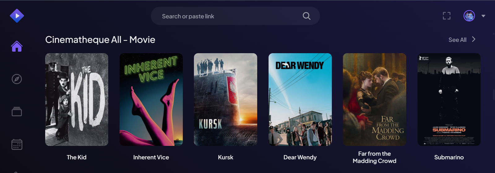
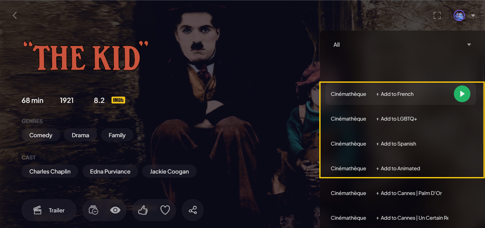
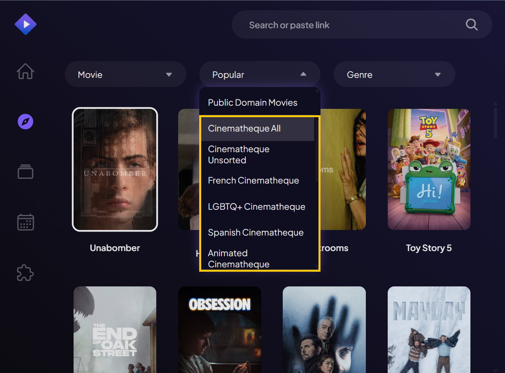
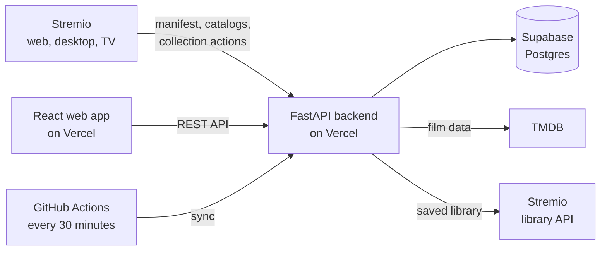

# Cinematheque Categorizer


[](https://github.com/leanardiles/cinematheque-categorizer/actions/workflows/tests.yml)

> **In daily use.** The addon, the web app and library sync are deployed and used every day on Stremio Web, desktop and TV, by me and a few invited users. Ideas for future work are tracked in the [roadmap](ROADMAP.md).

A Stremio addon and web app for organizing a movie and TV library into collections. Invite only: each user connects their own Stremio account and gets their own collections and addon address.

Stremio's library is a flat list with no way to group titles. This project lets me create collections (for example French, Argentinian, Animated) and add films to them, similar to collections on an e-reader. A film can belong to several collections or to none. Each collection appears in Stremio as its own row on the home screen and in Discover, on web and TV, and playback still works through whatever stream addons are installed.

**Live:** [cinematheque-categorizer.vercel.app](https://cinematheque-categorizer.vercel.app) (web app, sign-in by invitation) · [cinematheque-api.vercel.app](https://cinematheque-api.vercel.app) (API)

## In Stremio

Each collection becomes a row on the Stremio home screen, next to Cinematheque All (the whole library, most recently saved first) and Cinematheque Unsorted.



Filing works from inside Stremio. Each collection appears as a source on the film's page; selecting it adds the film to that collection (or removes it) without playing anything, on web, desktop and TV.



The collections are also available as catalogs in Discover.



## Features

Working now:

* Stremio addon serving one catalog per collection, in a manually arranged order, from a Postgres database
* Titles stored with their original title (English fallback for non-Latin scripts), English title and original language from TMDB
* Management API: collections (create, rename, delete, reorder), library (add by IMDb ID or TMDB search, rename, delete, unsorted filter) and collection contents (add, remove, reorder)
* React and TypeScript web app in a dark vintage cinema design: library (All and Unsorted), poster grids, a menu to file each film in collections, search, sorting, drag to reorder collections
* Sync from the Stremio library every 30 minutes (GitHub Actions), with Cinematheque All and Cinematheque Unsorted rows in Stremio
* Add to or remove from a collection inside Stremio, on web, desktop and TV: each collection appears as a source on the film's page, and selecting it files the film without playing anything
* Notes on films (who recommended it, why it matters): a note icon on each poster, notes included in search, and shown as the first Cinémathèque entry on the film's page in Stremio
* Multiple users, invite only: an invite link creates an email and password login, the user connects their Stremio account (by password or access key) and installs their own addon address in one click; every user's data is isolated
* Security: tokens stored as SHA-256 hashes, passwords as Argon2id hashes with a pause after repeated failures, each user's Stremio auth key encrypted at rest; Stremio passwords are exchanged for an auth key once and never stored
* Automated backend tests on every push (GitHub Actions), including checks that one user can never read or change another user's data
* Everything deployed on Vercel; every push to `main` redeploys

Possible next steps: Letterboxd import, and filters by director, country and year (see the [roadmap](ROADMAP.md)).

## How it works



* **Addon:** Stremio addons are HTTP services that return JSON. Stremio reads the addon's `manifest.json` to learn which catalogs it provides, then requests those catalogs to fill rows in its interface. Titles are identified by IMDb ID, so stream addons such as Torrentio can provide playback for any title this addon lists. Each user's addon URL carries their own private token, which identifies them.
* **Management API:** the web app calls `/api/...` endpoints with a web token: one per signed-in device, issued by the email and password login (or by an invite link). Film data comes from TMDB, with Cinemeta (Stremio's metadata service) as a fallback.
* **Accounts:** addon tokens and web tokens live in a `user_tokens` table as SHA-256 hashes, so a database leak reveals no working token, and each can be revoked on its own. Invite links are single use: they stop working once the user has created a login.
* **Sync:** every 30 minutes the scheduled job reads each connected user's Stremio library with their own auth key (decrypted in memory only), so one user's expired key never stops the others.
* **Database:** one row per film per user, keyed by IMDb ID, so the same film from different sources is never duplicated. Every table is scoped by user.

## Stack

* **Backend:** Python, FastAPI, SQLAlchemy, Alembic, httpx, argon2-cffi (passwords), cryptography (Fernet, for Stremio keys)
* **Tests:** pytest with an in-memory SQLite database, run by GitHub Actions
* **Database:** Supabase Postgres (transaction pooler)
* **Frontend:** React, TypeScript, Vite, CSS Modules with design tokens
* **Hosting:** Vercel (two projects from one repo: `backend/` and `frontend/`)
* **Metadata:** TMDB API, Cinemeta
* **Secrets:** 1Password CLI

## API overview

`/api` routes require `Authorization: Bearer <web token>`, except `POST /api/login`. Interactive docs are at `/docs`.

| Area | Endpoints |
| --- | --- |
| Account | `POST /api/login`, `POST /api/logout`, `GET /api/me`, `POST /api/me/login` (create or change the login), `POST /api/me/addon-link` |
| Stremio connection | `POST/DELETE /api/stremio/connect` |
| Collections | `GET/POST /api/collections`, `PATCH/DELETE /api/collections/{id}`, `PUT /api/collections/order` |
| Collection contents | `GET/POST /api/collections/{id}/titles`, `DELETE /api/collections/{id}/titles/{title_id}`, `PUT /api/collections/{id}/titles/order` |
| Library | `GET/POST /api/titles`, `PATCH/DELETE /api/titles/{id}` (rename, or set the note) |
| Search | `GET /api/search?q=...&type=movie` |
| Stremio addon | `GET /{addon_token}/manifest.json`, `GET /{addon_token}/catalog/{type}/{id}.json`, `GET /{addon_token}/stream/{type}/{id}.json` |
| Collection actions | `GET /{addon_token}/do/{add\|remove}/{collection_id}/{imdb_id}/catalog/...` (reached from the Stremio source links) |
| Sync | `POST /api/sync` (`SYNC_SECRET` syncs every user; a web token syncs that user) |

## Local development

### Prerequisites

* Python 3.10+ (production runs 3.12)
* Node.js 20.19+ or 22.12+
* [1Password CLI](https://developer.1password.com/docs/cli/) with access to the project vault
* [cloudflared](https://developers.cloudflare.com/cloudflare-one/connections/connect-networks/downloads/) (only for testing the local backend in Stremio)

### Setup

```bash
cd backend
python -m venv .venv
source .venv/Scripts/activate   # Windows (Git Bash)
# source .venv/bin/activate     # Linux / macOS / WSL
pip install -r requirements-dev.txt   # app dependencies plus pytest
op run --env-file=../.env.op -- alembic upgrade head

cd ../frontend
npm install
```

### Environment variables

Secrets are not stored in the repo. `.env.op` contains 1Password references that `op run` resolves at runtime:

| Variable | Purpose |
| --- | --- |
| `DATABASE_URL` | Supabase transaction pooler connection string |
| `TMDB_READ_TOKEN` | TMDB API read access token |
| `SYNC_SECRET` | Lets the scheduled job run the sync for every user |
| `ENCRYPTION_KEY` | Fernet key that encrypts users' Stremio auth keys; never change it, or users must reconnect Stremio |
| `ADDON_TOKEN`, `API_TOKEN`, `STREMIO_AUTH_KEY` | Single-user values from before accounts existed, read once by `python -m app.accounts import-env`; no longer used by the app |

The frontend reads `VITE_API_URL` (the API's base URL) from `frontend/.env.development` locally and from the Vercel project settings in production. It is not a secret.

### Run

Start the backend and the frontend together, and open a dev shell at the repo root with the venv active:

```bash
./scripts/dev.sh
```

Logs from both appear in the same window, labeled `[api]` and `[web]`. Ctrl+C stops everything.

* Frontend: http://localhost:5173
* Backend: http://localhost:8000 (API docs at `/docs`)

To test the local backend in Stremio, also start a Cloudflare quick tunnel:

```bash
./scripts/dev.sh --tunnel
```

Turn off any VPN first, since it can block the tunnel. Install the addon with `https://<tunnel-subdomain>.trycloudflare.com/<your addon token>/manifest.json` (the local backend uses the same database, so your usual addon token works). The deployed addon on Vercel doesn't need the tunnel.

### Tests

```bash
cd backend
pytest
```

No secrets or database needed: the tests use an in-memory SQLite database and fake settings, and simulate Stremio. They also run on every push through `.github/workflows/tests.yml`.

### Users and invites

```bash
cd backend
op run --env-file=../.env.op -- python -m app.accounts invite "Name"     # new user, prints a single-use invite link
op run --env-file=../.env.op -- python -m app.accounts list              # users, logins, tokens, Stremio status
op run --env-file=../.env.op -- python -m app.accounts new-link <id>     # new link, also to reset a forgotten password
op run --env-file=../.env.op -- python -m app.accounts revoke <id>       # revoke every link, session and addon address
```

The invite link signs the user in once and asks them to create an email and password login, then to connect Stremio and install their addon.

### Database migrations

```bash
cd backend
op run --env-file=../.env.op -- alembic revision --autogenerate -m "describe the change"
op run --env-file=../.env.op -- alembic upgrade head
```

Review each generated file in `migrations/versions/` before applying it, and commit it with the model change.

## Project structure

```
cinematheque-categorizer/
├── backend/
│   ├── app/
│   │   ├── addon/          Stremio manifest, catalog, source and collection action routes
│   │   ├── api/            Management API: account, collections, titles, search, sync, schemas
│   │   ├── accounts.py     Tokens, passwords, encrypted Stremio keys, and the accounts commands
│   │   ├── stremio.py      Stremio library API client (login, library)
│   │   ├── sync.py         Library sync, per user
│   │   ├── cinemeta.py     Cinemeta client (fallback metadata)
│   │   ├── tmdb.py         TMDB client: lookup, search, original titles
│   │   ├── models.py       SQLAlchemy models
│   │   ├── db.py           Engine and sessions for the Supabase pooler
│   │   ├── deps.py         Shared auth and user dependencies
│   │   ├── config.py       Settings loaded from environment
│   │   ├── sync_run.py     Full sync from the terminal (sync_preview.py: dry run)
│   │   ├── seed.py         Test data
│   │   ├── backfill_tmdb.py  One-off: fill TMDB fields for existing titles
│   │   └── main.py         FastAPI app and CORS
│   ├── migrations/         Alembic migrations
│   ├── tests/              pytest suite (accounts, isolation, login, notes, sync)
│   ├── requirements.txt
│   └── requirements-dev.txt
├── frontend/
│   ├── public/             Favicon and home screen icon
│   └── src/
│       ├── api/            Typed API client and response types
│       ├── components/     Sign-in, onboarding (login, Stremio, addon), sidebar, library and collection views
│       ├── lib/            Search, sorting and language helpers
│       └── styles/         Design tokens and global styles
├── docs/
│   ├── reference/          Notes on the unofficial Stremio library API
│   └── screenshots/        Images used in this README
├── .github/workflows/      Scheduled sync and tests
├── scripts/
│   ├── dev.sh              Starts backend, frontend and optional tunnel, opens a dev shell
│   └── venv-shell.rc       Startup file for the dev shell
├── .env.op                 1Password secret references
└── ROADMAP.md              Milestones and progress
```

## Attribution

This product uses the TMDB API but is not endorsed or certified by TMDB.

## Disclaimer

This addon only organizes metadata about titles in its users' own Stremio libraries. It does not host, index, or provide any media content.
